<div align="center">



<br>

**Describe lo que quieres hacer. vera escribe el comando. Tú decides si se ejecuta.**<br>
Un modelo de IA local con [Ollama](https://ollama.com): nada sale de tu ordenador.

[](https://github.com/olivertazuecobaraza-olipite/vera/actions/workflows/ci.yml)
[](https://github.com/olivertazuecobaraza-olipite/vera/releases/latest)
[](https://www.npmjs.com/package/vera-ia)
[](LICENSE)
[](https://scorecard.dev/viewer/?uri=github.com/olivertazuecobaraza-olipite/vera)

[English](README.md) · **Español**

[Instalación](#-instalación) · [Uso](#-uso) · [Ollama y modelos](#-ollama-y-modelos-vera-ollama) · [Ajustes](#%EF%B8%8F-ajustes-vera-config) · [Desarrollo](#%EF%B8%8F-desarrollo)

</div>

---

## ✨ Por qué vera

|   |   |
|---|---|
| 🔒 **100 % local** | El modelo corre en tu ordenador con Ollama. Sin claves de API, sin cuentas y sin enviar nada a internet. |
| 🧠 **Conoce tu sistema** | Detecta tu sistema, tu distribución, tu shell (zsh, bash, PowerShell, cmd…) y tu gestor de paquetes (apt, dnf, pacman, zypper, apk, brew, winget, Scoop…) y pide comandos adecuados para ellos. |
| 🛑 **Siempre pregunta antes** | Ves el comando y una explicación de una línea antes de que se ejecute nada. |
| 🚨 **Avisa de lo peligroso** | Borrar carpetas, formatear discos, ejecutar un script descargado… sale en rojo con el motivo. vera lo comprueba por su cuenta, no se fía solo del modelo. |
| 📋 **Copiar en vez de ejecutar** | Pulsa `c` y el comando va al portapapeles. |
| 🪄 **Se instala solo lo que falta** | `vera ollama` instala Ollama y descarga el modelo, sin permisos de administrador. |
| 🖥️ **En todas partes** | macOS, Linux y Windows, en x86-64 y ARM64. Un único binario, sin dependencias. |

## 🚀 Empezar en 30 segundos

```sh
brew install olivertazuecobaraza-olipite/tap/vera   # o cualquier método de abajo
vera ollama                                         # instala Ollama y el modelo (solo la primera vez)
vera busca los 10 archivos más grandes de esta carpeta
```

> También lo puedes llamar **`ia`**: es el mismo programa (`ia lista los puertos abiertos`).

## 📦 Instalación

Elige lo que ya uses. Todos instalan el mismo binario, con atestación de compilación verificable, de la [última release](https://github.com/olivertazuecobaraza-olipite/vera/releases/latest).

| Sistema | Recomendado | También |
|---|---|---|
| 🍎 **macOS** | `brew install olivertazuecobaraza-olipite/tap/vera` | script · npm/pnpm/yarn/bun · Go |
| 🐧 **Linux** | script, o el paquete de tu distribución | Homebrew · `.deb` · `.rpm` · `.apk` · npm · Go |
| 🪟 **Windows** | `winget install Olipite.Vera` | script de PowerShell · Scoop · npm/pnpm/yarn/bun · Go |

<details>
<summary><b>🍺 Homebrew</b> (macOS · Linux)</summary>

```sh
brew install olivertazuecobaraza-olipite/tap/vera
```

Instala `vera` e `ia`. Se actualiza con el resto de tus paquetes (`brew upgrade`).
</details>

<details>
<summary><b>📜 Script de instalación</b> (macOS · Linux)</summary>

```sh
curl -fsSL https://raw.githubusercontent.com/olivertazuecobaraza-olipite/vera/main/install.sh | sh
```

- Se instala en `~/.local/bin` (con el alias `ia`), **sin sudo**.
- Descarga la última release y **comprueba su suma SHA-256** antes de instalar.
- Opciones: `VERA_VERSION=1.2.0` para una versión concreta y `VERA_INSTALL_DIR=/ruta` para otra carpeta.

```sh
curl -fsSL https://raw.githubusercontent.com/olivertazuecobaraza-olipite/vera/main/install.sh | VERA_VERSION=1.0.0 sh
```

¿Prefieres leerlo antes? Descarga [`install.sh`](install.sh), ábrelo y luego `sh install.sh`.
</details>

<details>
<summary><b>🪟 Script de PowerShell</b> (Windows)</summary>

```powershell
irm https://raw.githubusercontent.com/olivertazuecobaraza-olipite/vera/main/install.ps1 | iex
```

Instala `vera.exe` e `ia.exe` en `%LOCALAPPDATA%\Programs\vera` y lo añade a tu `PATH` (abre una terminal nueva después). Sin permisos de administrador. Comprueba la suma SHA-256. Para una versión concreta: `$env:VERA_VERSION = "1.0.0"` antes de ejecutarlo.
</details>

<details>
<summary><b>📦 winget</b> (Windows)</summary>

```powershell
winget install Olipite.Vera
```
</details>

<details>
<summary><b>🥄 Scoop</b> (Windows)</summary>

```powershell
scoop bucket add vera https://github.com/olivertazuecobaraza-olipite/scoop-bucket
scoop install vera
```
</details>

<details>
<summary><b>🟥 npm · pnpm · yarn · bun</b> (macOS · Linux · Windows)</summary>

```sh
npm  install -g vera-ia
pnpm add -g vera-ia
yarn global add vera-ia      # Yarn 1
bun  add -g vera-ia
```

El paquete se llama **`vera-ia`** (`vera` ya existía en npm), pero los comandos que instala son `vera` e `ia`. Solo se descarga el binario de tu plataforma y no hay script `postinstall`, así que funciona también con la seguridad por defecto de pnpm y bun.

**Pruébalo sin instalar:**

```sh
npx -p vera-ia vera lista los archivos de esta carpeta
bunx --package vera-ia vera lista los archivos de esta carpeta
pnpm dlx --package vera-ia vera lista los archivos de esta carpeta
```
</details>

<details>
<summary><b>🍥 Debian · Ubuntu</b> (<code>.deb</code>)</summary>

```sh
gh release download -R olivertazuecobaraza-olipite/vera -p '*_amd64.deb'   # arm64: '*_arm64.deb'
sudo apt install ./vera_*_amd64.deb
```

¿Sin `gh`? Descarga el `.deb` desde la [página de releases](https://github.com/olivertazuecobaraza-olipite/vera/releases/latest). Instala `/usr/bin/vera` y `/usr/bin/ia`.
</details>

<details>
<summary><b>🎩 Fedora · RHEL · openSUSE</b> (<code>.rpm</code>)</summary>

```sh
gh release download -R olivertazuecobaraza-olipite/vera -p '*.x86_64.rpm'   # ARM: '*.aarch64.rpm'
sudo dnf install ./vera-*.x86_64.rpm        # openSUSE: sudo zypper install ./vera-*.rpm
```
</details>

<details>
<summary><b>🏔️ Alpine</b> (<code>.apk</code>)</summary>

```sh
gh release download -R olivertazuecobaraza-olipite/vera -p '*_x86_64.apk'   # ARM: '*_aarch64.apk'
sudo apk add --allow-untrusted ./vera_*_x86_64.apk
```
</details>

<details>
<summary><b>🐹 Go</b></summary>

```sh
go install github.com/olivertazuecobaraza-olipite/vera/cmd/vera@latest
```

Hace falta Go 1.25+. Instala solo `vera` (para el alias: `ln -s vera "$(go env GOPATH)/bin/ia"`).
</details>

<details>
<summary><b>🗜️ Descarga manual</b></summary>

1. Descarga el `.tar.gz` (macOS, Linux) o el `.zip` (Windows) de tu sistema desde la [página de releases](https://github.com/olivertazuecobaraza-olipite/vera/releases/latest).
2. Descomprímelo y pon `vera` (o `vera.exe`) en una carpeta de tu `PATH`.
3. Opcional: compruébalo con `checksums.txt` (`shasum -a 256 -c checksums.txt --ignore-missing`).
</details>

<details>
<summary><b>🛠️ Desde el código</b></summary>

```sh
git clone https://github.com/olivertazuecobaraza-olipite/vera && cd vera
./build.sh          # compila todos los binarios en dist/
./install.sh        # instala el de tu sistema (Windows: .\install.ps1)
```
</details>

### 🔁 Actualizar y desinstalar

| Instalado con | Actualizar | Desinstalar |
|---|---|---|
| Homebrew | `brew upgrade vera` | `brew uninstall vera` |
| Script | volver a ejecutarlo | `rm ~/.local/bin/vera ~/.local/bin/ia` |
| Script de PowerShell | volver a ejecutarlo | borrar `%LOCALAPPDATA%\Programs\vera` y quitarlo del `PATH` |
| winget | `winget upgrade Olipite.Vera` | `winget uninstall Olipite.Vera` |
| Scoop | `scoop update vera` | `scoop uninstall vera` |
| npm | `npm install -g vera-ia@latest` | `npm uninstall -g vera-ia` |
| pnpm | `pnpm update -g vera-ia` | `pnpm remove -g vera-ia` |
| yarn | `yarn global upgrade vera-ia` | `yarn global remove vera-ia` |
| bun | `bun add -g vera-ia@latest` | `bun remove -g vera-ia` |
| `.deb` | instalar el `.deb` nuevo | `sudo apt remove vera` |
| `.rpm` | instalar el `.rpm` nuevo | `sudo dnf remove vera` |
| `.apk` | instalar el `.apk` nuevo | `sudo apk del vera` |
| Go | volver a ejecutar `go install` | `rm "$(go env GOPATH)/bin/vera"` |

### 🔐 Verifica lo que descargas

Cada archivo de una release lleva una **atestación de procedencia** firmada por GitHub Actions, que prueba que se compiló en este repositorio con su workflow de publicación:

```sh
gh attestation verify vera_1.0.0_linux_amd64.tar.gz --repo olivertazuecobaraza-olipite/vera
```

Los paquetes de npm se publican con [trusted publishing](https://docs.npmjs.com/trusted-publishers) (sin tokens) y llevan la procedencia de npm. Los `.deb`, `.rpm` y `.apk` no están firmados con GPG: compruébalos con `checksums.txt` o con la atestación.

## 💬 Uso

```sh
vera qué proceso usa el puerto 3000
vera comprime la carpeta fotos en un zip
ia muéstrame mi IP local
```

vera responde con un comando y una explicación corta, y pregunta:

```
❯ lsof -i :3000
  Muestra qué procesos están utilizando el puerto 3000.
¿Ejecutar? [s/N/c=copiar]
```

| Tecla | Qué hace |
|---|---|
| `s` | lo ejecuta |
| `Enter` / `n` | no hace nada |
| `c` | lo copia al portapapeles (`pbcopy`, `clip.exe`, `wl-copy`, `xclip` o `xsel`) |

> [!TIP]
> Puedes **pedirlo en cualquier idioma**: la explicación llega en el idioma que uses.

Si tu petición es una sola palabra que coincide con un subcomando (`ollama`, `config`), escribe `--` delante: `vera -- config`.

## 🦙 Ollama y modelos: `vera ollama`

```sh
vera ollama               # modelo por defecto
vera ollama llama3.2      # o el que quieras de https://ollama.com/search
```

1. **Instala Ollama** si no está (con barra de progreso):
   - **macOS:** `Ollama.app` en `/Applications` (o `~/Applications` si no hay permisos).
   - **Linux:** en `~/.local/bin/ollama`, sin sudo. Si ya tienes Ollama como servicio del sistema, vera te dirá que lo arranques con `sudo systemctl start ollama`.
   - **Windows:** con el instalador oficial, en tu cuenta y sin permisos de administrador.
2. **Arranca Ollama** si no está abierto.
3. **Descarga el modelo**, después de decirte cuánto ocupa y pedir confirmación. Si el nombre no existe, avisa antes de empezar.
4. **Lo guarda como modelo por defecto de vera.** `VERA_MODEL`, si está definida, tiene prioridad.

Si pulsas Ctrl+C durante la descarga, al repetir el comando sigue donde se quedó. Los modelos que no sirven para conversar (p. ej. de embeddings) se rechazan, y vera ofrece borrarlos.

No hace falta ejecutar `vera ollama` antes: si Ollama está cerrado, vera lo arranca solo; si falta Ollama o el modelo, te pregunta si quieres instalarlo.

## ⚙️ Ajustes: `vera config`

Un menú sencillo, con números:

```
Configuración de vera

  1) Modelo por defecto                qwen3.5:9b-mlx
  2) Confirmar antes de descargar      sí
  3) Abrir Ollama al iniciar sesión    automático (lo hace la app de Ollama)
  4) Borrar modelos
  0) Salir
```

1. **Modelo por defecto:** elige entre tus modelos de chat, o escribe otro y se descarga.
2. **Confirmar antes de descargar:** en «no», los modelos se descargan sin preguntar.
3. **Abrir Ollama al iniciar sesión:** en macOS y Windows lo hace la app de Ollama. En Linux (si Ollama lo instaló vera) se activa con un servicio de usuario de systemd. Aunque esté desactivado, vera abre Ollama cuando lo necesita.
4. **Borrar modelos:** muestra lo que ocupa cada uno; se pueden borrar varios a la vez (p. ej. `1,3`).

Los ajustes se guardan en `config.json` en la carpeta de configuración del usuario: `~/Library/Application Support/vera` (macOS), `~/.config/vera` (Linux), `%AppData%\vera` (Windows).

### Variables de entorno

| Variable | Para qué | Por defecto |
|---|---|---|
| `VERA_MODEL` | Modelo de Ollama (tiene prioridad sobre el elegido con `vera ollama`) | `qwen3.5:9b-mlx` en Mac Apple Silicon, `qwen3.5:9b` en el resto |
| `OLLAMA_HOST` | Dónde está Ollama (puede ser otro ordenador) | `127.0.0.1:11434` |
| `VERA_SHELL` | Shell con la que ejecutar. En Windows, `cmd` para usar cmd.exe | `$SHELL` / PowerShell |
| `NO_COLOR` | Desactiva los colores | — |

## 🛠️ Desarrollo

Hace falta [Go](https://go.dev) 1.25+. La arquitectura está en [ARQUITECTURA.md](ARQUITECTURA.md) y cómo contribuir (ramas, commits convencionales, releases) en [CONTRIBUTING.md](CONTRIBUTING.md).

```sh
./build.sh                   # todos los binarios en dist/
./build.sh test              # tests rápidos (sin red ni Ollama)
./build.sh cover             # cobertura (informe en cover.html)
./build.sh integration       # también los tests con Ollama de verdad (VERA_TEST_MODEL elige el modelo)
./build.sh golden            # regenera los golden files si cambias el prompt a propósito
go build -o vera ./cmd/vera  # solo para tu sistema
```

```
cmd/vera/          punto de entrada: monta las piezas
internal/cli/      argumentos (Cobra), preguntas al usuario y flujos
internal/suggest/  prompt, salida JSON del modelo y detección de comandos peligrosos
internal/llm/      cliente de Ollama (/api/chat)
internal/setup/    instalar y arrancar Ollama, descargar y borrar modelos
internal/config/   config.json y variables de entorno
internal/sysinfo/  sistema, distribución, shell y gestor de paquetes
internal/ui/       colores, preguntas, barra de progreso, spinner y portapapeles
```

## ⚠️ Aviso

Un modelo pequeño se equivoca a veces. **Lee el comando antes de pulsar `s`**, sobre todo si borra, mueve o sobrescribe archivos.

## 🛡️ Seguridad y licencia

- Vulnerabilidades: en privado, siguiendo [SECURITY.md](SECURITY.md).
- Código de conducta: [CODE_OF_CONDUCT.md](CODE_OF_CONDUCT.md).
- Licencia: [MIT](LICENSE).

<div align="center">
<sub>Hecho con ☕ y un LLM local · <a href="https://github.com/olivertazuecobaraza-olipite/vera">github.com/olivertazuecobaraza-olipite/vera</a></sub>
</div>
