<div align="center">



<br>

**Describe what you want to do. vera writes the command. You decide whether to run it.**<br>
A local AI model running on [Ollama](https://ollama.com): nothing leaves your machine.

[](https://github.com/olivertazuecobaraza-olipite/vera/actions/workflows/ci.yml)
[](https://github.com/olivertazuecobaraza-olipite/vera/releases/latest)
[](https://www.npmjs.com/package/vera-ia)
[](LICENSE)
[](https://scorecard.dev/viewer/?uri=github.com/olivertazuecobaraza-olipite/vera)

**English** · [Español](README.es.md)

[Install](#-install) · [Usage](#-usage) · [Ollama & models](#-ollama--models-vera-ollama) · [Settings](#%EF%B8%8F-settings-vera-config) · [Development](#%EF%B8%8F-development)

</div>

---

## ✨ Why vera

|   |   |
|---|---|
| 🔒 **100% local** | The model runs on your computer with Ollama. No API keys, no accounts, nothing sent to the internet. |
| 🧠 **Knows your system** | Detects your OS, distro, shell (zsh, bash, PowerShell, cmd…) and package manager (apt, dnf, pacman, zypper, apk, brew, winget, Scoop…) and asks for commands that fit them. |
| 🛑 **Always asks first** | You see the command and a one-line explanation before anything runs. |
| 🚨 **Flags dangerous commands** | Deleting folders, formatting disks, piping a downloaded script into a shell… shown in red with the reason. vera checks on its own; it doesn't just trust the model. |
| 📋 **Copy instead of run** | Press `c` to copy the command to the clipboard. |
| 🪄 **Sets itself up** | `vera ollama` installs Ollama and downloads the model for you, with no admin rights needed. |
| 🖥️ **Everywhere** | macOS, Linux and Windows, on x86-64 and ARM64. One static binary, no dependencies. |

## 🚀 Quick start

```sh
brew install olivertazuecobaraza-olipite/tap/vera   # or any method below
vera ollama                                         # installs Ollama + the model (one-time)
vera find the 10 biggest files in this folder
```

> You can also call it **`ia`**: it's the same program (`ia list the open ports`).

## 📦 Install

Pick whatever you already use. They all install the same binary, with a verifiable build attestation, from the [latest release](https://github.com/olivertazuecobaraza-olipite/vera/releases/latest).

| Platform | Recommended | Also available |
|---|---|---|
| 🍎 **macOS** | `brew install olivertazuecobaraza-olipite/tap/vera` | install script · npm/pnpm/yarn/bun · Go |
| 🐧 **Linux** | install script, or your distro's package | Homebrew · `.deb` · `.rpm` · `.apk` · AUR · npm · Go |
| 🪟 **Windows** | `winget install Olipite.Vera` | PowerShell script · Scoop · npm/pnpm/yarn/bun · Go |

> [!NOTE]
> The package managers (Homebrew, winget, Scoop, AUR, `.deb`/`.rpm`/`.apk`) are available **starting with v1.1.0**. npm and the install scripts already work.

<details>
<summary><b>🍺 Homebrew</b> (macOS · Linux)</summary>

```sh
brew install olivertazuecobaraza-olipite/tap/vera
```

Installs `vera` and `ia`. Homebrew upgrades it with the rest of your packages (`brew upgrade`).
</details>

<details>
<summary><b>📜 Install script</b> (macOS · Linux)</summary>

```sh
curl -fsSL https://raw.githubusercontent.com/olivertazuecobaraza-olipite/vera/main/install.sh | sh
```

- Installs to `~/.local/bin` (with the `ia` alias), **no sudo**.
- Downloads the latest release and **verifies its SHA-256 checksum** before installing.
- Options: `VERA_VERSION=1.2.0` for a specific version, `VERA_INSTALL_DIR=/path` for another folder.

```sh
curl -fsSL https://raw.githubusercontent.com/olivertazuecobaraza-olipite/vera/main/install.sh | VERA_VERSION=1.0.0 sh
```

Prefer to read it first? Download [`install.sh`](install.sh), open it, then run `sh install.sh`.
</details>

<details>
<summary><b>🪟 PowerShell script</b> (Windows)</summary>

```powershell
irm https://raw.githubusercontent.com/olivertazuecobaraza-olipite/vera/main/install.ps1 | iex
```

Installs `vera.exe` and `ia.exe` to `%LOCALAPPDATA%\Programs\vera` and adds it to your user `PATH` (open a new terminal afterwards). No admin rights. Verifies the SHA-256 checksum. For a specific version: `$env:VERA_VERSION = "1.0.0"` before running it.
</details>

<details>
<summary><b>📦 winget</b> (Windows)</summary>

```powershell
winget install Olipite.Vera
```
</details>

<details>
<summary><b>🥄 Scoop</b> (Windows)</summary>

```powershell
scoop bucket add vera https://github.com/olivertazuecobaraza-olipite/scoop-bucket
scoop install vera
```
</details>

<details>
<summary><b>🟥 npm · pnpm · yarn · bun</b> (macOS · Linux · Windows)</summary>

```sh
npm  install -g vera-ia
pnpm add -g vera-ia
yarn global add vera-ia      # Yarn 1
bun  add -g vera-ia
```

The package is called **`vera-ia`** (`vera` was taken on npm), but the commands it installs are `vera` and `ia`. Only the binary for your platform is downloaded, and there's no `postinstall` script, so it works with pnpm and bun's default security settings too.

**Try it without installing:**

```sh
npx -p vera-ia vera list the files in this folder
bunx --package vera-ia vera list the files in this folder
pnpm dlx --package vera-ia vera list the files in this folder
```
</details>

<details>
<summary><b>🍥 Debian · Ubuntu</b> (<code>.deb</code>)</summary>

```sh
gh release download -R olivertazuecobaraza-olipite/vera -p '*_amd64.deb'   # arm64: '*_arm64.deb'
sudo apt install ./vera_*_amd64.deb
```

No `gh`? Download the `.deb` from the [releases page](https://github.com/olivertazuecobaraza-olipite/vera/releases/latest). Installs `/usr/bin/vera` and `/usr/bin/ia`.
</details>

<details>
<summary><b>🎩 Fedora · RHEL · openSUSE</b> (<code>.rpm</code>)</summary>

```sh
gh release download -R olivertazuecobaraza-olipite/vera -p '*.x86_64.rpm'   # ARM: '*.aarch64.rpm'
sudo dnf install ./vera-*.x86_64.rpm        # openSUSE: sudo zypper install ./vera-*.rpm
```
</details>

<details>
<summary><b>🏔️ Alpine</b> (<code>.apk</code>)</summary>

```sh
gh release download -R olivertazuecobaraza-olipite/vera -p '*_x86_64.apk'   # ARM: '*_aarch64.apk'
sudo apk add --allow-untrusted ./vera_*_x86_64.apk
```
</details>

<details>
<summary><b>🏹 Arch Linux</b> (AUR)</summary>

```sh
yay -S vera-bin      # or: paru -S vera-bin
```
</details>

<details>
<summary><b>🐹 Go</b></summary>

```sh
go install github.com/olivertazuecobaraza-olipite/vera/cmd/vera@latest
```

Needs Go 1.25+. Installs `vera` only (to create the alias: `ln -s vera "$(go env GOPATH)/bin/ia"`).
</details>

<details>
<summary><b>🗜️ Manual download</b></summary>

1. Download the `.tar.gz` (macOS, Linux) or `.zip` (Windows) for your system from the [releases page](https://github.com/olivertazuecobaraza-olipite/vera/releases/latest).
2. Extract it and put `vera` (or `vera.exe`) somewhere on your `PATH`.
3. Optional: verify it with `checksums.txt` (`shasum -a 256 -c checksums.txt --ignore-missing`).
</details>

<details>
<summary><b>🛠️ From source</b></summary>

```sh
git clone https://github.com/olivertazuecobaraza-olipite/vera && cd vera
./build.sh          # builds every binary into dist/
./install.sh        # installs the one for your system (Windows: .\install.ps1)
```
</details>

### 🔁 Update & uninstall

| Installed with | Update | Uninstall |
|---|---|---|
| Homebrew | `brew upgrade vera` | `brew uninstall vera` |
| Install script | run it again | `rm ~/.local/bin/vera ~/.local/bin/ia` |
| PowerShell script | run it again | delete `%LOCALAPPDATA%\Programs\vera` and remove it from `PATH` |
| winget | `winget upgrade Olipite.Vera` | `winget uninstall Olipite.Vera` |
| Scoop | `scoop update vera` | `scoop uninstall vera` |
| npm | `npm install -g vera-ia@latest` | `npm uninstall -g vera-ia` |
| pnpm | `pnpm update -g vera-ia` | `pnpm remove -g vera-ia` |
| yarn | `yarn global upgrade vera-ia` | `yarn global remove vera-ia` |
| bun | `bun add -g vera-ia@latest` | `bun remove -g vera-ia` |
| `.deb` | install the new `.deb` | `sudo apt remove vera` |
| `.rpm` | install the new `.rpm` | `sudo dnf remove vera` |
| `.apk` | install the new `.apk` | `sudo apk del vera` |
| AUR | `yay -Syu` | `sudo pacman -R vera-bin` |
| Go | run `go install` again | `rm "$(go env GOPATH)/bin/vera"` |

### 🔐 Verify what you download

Every file in a release comes with a **build provenance attestation** signed by GitHub Actions, which proves it was built from this repository by its release workflow:

```sh
gh attestation verify vera_1.0.0_linux_amd64.tar.gz --repo olivertazuecobaraza-olipite/vera
```

The npm packages are published with [trusted publishing](https://docs.npmjs.com/trusted-publishers) (no tokens) and carry npm provenance. The `.deb`, `.rpm` and `.apk` packages aren't GPG-signed: check them with `checksums.txt` or the attestation.

## 💬 Usage

```sh
vera what process is using port 3000
vera compress the photos folder into a zip
ia show my local IP address
```

vera answers with a command and a short explanation, then asks:

```
❯ lsof -i :3000
  Shows which processes are using port 3000.
¿Ejecutar? [s/N/c=copiar]
```

| Key | What it does |
|---|---|
| `s` | runs it (*sí*, "yes") |
| `Enter` / `n` | does nothing |
| `c` | copies it to the clipboard (`pbcopy`, `clip.exe`, `wl-copy`, `xclip` or `xsel`) |

> [!TIP]
> vera's interface is in Spanish, but you can **ask in any language**: the explanation comes back in the language you used.

If your request is a single word that matches a subcommand (`ollama`, `config`), put `--` in front: `vera -- config`.

## 🦙 Ollama & models: `vera ollama`

```sh
vera ollama               # default model
vera ollama llama3.2      # or any model from https://ollama.com/search
```

1. **Installs Ollama** if it's missing (with a progress bar):
   - **macOS:** `Ollama.app` in `/Applications` (or `~/Applications` without permissions).
   - **Linux:** `~/.local/bin/ollama`, no sudo. If Ollama is already a system service, vera tells you to run `sudo systemctl start ollama`.
   - **Windows:** the official installer, for your user, no admin rights.
2. **Starts Ollama** if it isn't running.
3. **Downloads the model**, after showing its size and asking. It warns you up front if the name doesn't exist.
4. **Saves it as vera's default model.** `VERA_MODEL` takes priority if set.

Press Ctrl+C during a download and it resumes next time. Models that can't chat (e.g. embedding models) are rejected, and vera offers to delete them.

You don't have to run `vera ollama` first: if Ollama is stopped, vera starts it; if Ollama or the model is missing, it offers to install them.

## ⚙️ Settings: `vera config`

A simple numbered menu:

```
Configuración de vera

  1) Modelo por defecto                qwen3.5:9b-mlx
  2) Confirmar antes de descargar      sí
  3) Abrir Ollama al iniciar sesión    automático (lo hace la app de Ollama)
  4) Borrar modelos
  0) Salir
```

1. **Default model:** pick one of your chat models, or type a new one to download it.
2. **Confirm before downloading:** set it to "no" to download models without asking.
3. **Open Ollama at login:** on macOS and Windows the Ollama app handles this. On Linux (if vera installed Ollama) it uses a systemd user service. Even when it's off, vera opens Ollama when needed.
4. **Delete models:** shows how much space each one uses; delete several at once (e.g. `1,3`).

Settings live in `config.json` in your user config folder: `~/Library/Application Support/vera` (macOS), `~/.config/vera` (Linux), `%AppData%\vera` (Windows).

### Environment variables

| Variable | What it does | Default |
|---|---|---|
| `VERA_MODEL` | Ollama model (overrides the one chosen with `vera ollama`) | `qwen3.5:9b-mlx` on Apple Silicon, `qwen3.5:9b` elsewhere |
| `OLLAMA_HOST` | Where Ollama runs (can be another machine) | `127.0.0.1:11434` |
| `VERA_SHELL` | Shell used to run commands. On Windows, `cmd` for cmd.exe | `$SHELL` / PowerShell |
| `NO_COLOR` | Turns colors off | — |

## 🛠️ Development

Needs [Go](https://go.dev) 1.25+. The architecture is explained in [ARQUITECTURA.md](ARQUITECTURA.md), and how to contribute (branches, conventional commits, releases) in [CONTRIBUTING.md](CONTRIBUTING.md) (both in Spanish).

```sh
./build.sh                   # every binary into dist/
./build.sh test              # fast tests (no network, no Ollama)
./build.sh cover             # coverage (report in cover.html)
./build.sh integration       # also tests against a real Ollama (VERA_TEST_MODEL picks the model)
./build.sh golden            # regenerate golden files after an intentional prompt change
go build -o vera ./cmd/vera  # just for your system
```

```
cmd/vera/          entry point: wires everything together
internal/cli/      arguments (Cobra), prompts and flows
internal/suggest/  prompt, the model's JSON output and dangerous-command detection
internal/llm/      Ollama client (/api/chat)
internal/setup/    install and start Ollama, download and delete models
internal/config/   config.json and environment variables
internal/sysinfo/  OS, distro, shell and package manager
internal/ui/       colors, prompts, progress bar, spinner and clipboard
```

## ⚠️ A word of caution

Small models get things wrong sometimes. **Read the command before pressing `s`**, especially if it deletes, moves or overwrites files.

## 🛡️ Security & license

- Vulnerabilities: report them privately, following [SECURITY.md](SECURITY.md).
- Code of conduct: [CODE_OF_CONDUCT.md](CODE_OF_CONDUCT.md).
- License: [MIT](LICENSE).

<div align="center">
<sub>Made with ☕ and a local LLM · <a href="https://github.com/olivertazuecobaraza-olipite/vera">github.com/olivertazuecobaraza-olipite/vera</a></sub>
</div>
